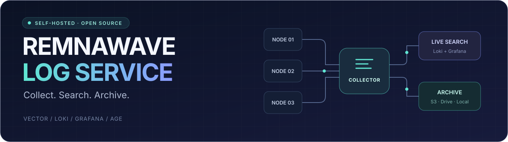

<div align="center">



[Русский](README.md) · **English**

[](https://github.com/evi1argument/remnawave-log-service/actions/workflows/check.yml)
[](LICENSE)

</div>

# Remnawave Log Service

Self-hosted log collection for Remnawave VPN fleets. Collect Xray access and
error logs over TLS with Vector, search them in Grafana with Loki, and archive
them to S3, Google Drive, or local storage with optional age encryption.

> **Deployment.** Use a dedicated Linux host. Keep Grafana and
> Loki on loopback and restrict collector TCP/6000 to your nodes at the network
> perimeter. See the [security policy](SECURITY.md) for reporting issues.

## How it works

| Collect | Search | Archive |
| --- | --- | --- |
| Vector agents with disk buffers | Loki and two dashboards in Grafana | S3, Google Drive, or local storage |
| Agents verify the collector certificate | Filter by node, IP, user ID, and destination | Optional age encryption and upload retries |

The mapping between numeric log IDs and account details stays on the panel
server. Looking up an account is a separate step. VPN logs can still contain
identifying information; restrict access and set retention accordingly.

## Quick start

You need Debian or Ubuntu with systemd, root access, IPv4, and
[Docker Engine 28+ with the Compose plugin](https://docs.docker.com/engine/install/).
Use Docker's iptables backend on the collector. Restrict TCP/6000 at the
provider firewall or use a private network before starting Docker services.

**1. Install the collector**

```bash
git clone https://github.com/evi1argument/remnawave-log-service.git
cd remnawave-log-service/collector
./install-collector.sh
```

The installer prompts for the archive backend and encryption settings. For a
dedicated collector that does not run a VPN node, use `COLLECTOR_NODE=-`.
The Grafana admin password is stored in `/opt/logcollector/.env` with access
restricted to root.

**2. Install each agent**

Run the following on a node where Xray writes access and error logs to
`/var/log/remnanode/`. Replace `COLLECTOR` and `NODE_NAME`. Verify the collector's
SSH host key before copying the public certificate.

```bash
git clone https://github.com/evi1argument/remnawave-log-service.git
cd remnawave-log-service/node
scp root@COLLECTOR:/opt/logcollector/vector/tls/cert.pem ./collector.crt
COLLECTOR_CERT=./collector.crt COLLECTOR_IP=COLLECTOR ./install-node.sh NODE_NAME
```

On the collector, add the node's actual source IPv4 address to the provider
firewall and to Docker's allow-list. If the node uses NAT, use its egress IP.

```bash
/opt/logcollector/scripts/collector-add-node-fw.sh NODE_IP
```

**3. Open Grafana over SSH**

```bash
ssh -N -L 3000:127.0.0.1:3000 root@COLLECTOR
```

Open `http://127.0.0.1:3000`, sign in as `admin`, and open the
**Remnawave Logs** folder. Confirm the node appears in **Fleet overview** and
search for a recent event in **Log search**.

## Choose an archive backend

| Backend | Setup |
| --- | --- |
| S3 | Create a bucket and a scoped service key. Enable Object Lock and versioning if immutable retention is required. |
| Google Drive | Configure an rclone remote and use age encryption. Drive has no built-in immutable retention. |
| Local | Store archives on a local disk and optionally pull them with `scripts/pull-to-pc.sh` over SSH. |

For age encryption, keep the private key off the collector. Loki's searchable
retention is separate from archive retention. To run the archive job manually:

```bash
systemctl start archive-upload.service
journalctl -u archive-upload.service -n 20
```

## Validation and upgrades

CI covers Bash syntax, archive regressions, configuration validation, and a
fresh collector and agent installation on Linux. It checks TLS delivery to
Loki, Grafana dashboards, and encryption and decryption of a local archive.
Live S3 and Google Drive or migration of an existing Grafana database need
separate validation. Review the [release notes](https://github.com/evi1argument/remnawave-log-service/releases)
for current limitations.

Back up settings, certificates, the archive queue, and volumes before upgrading.
The install scripts regenerate configuration. Follow the upgrade guide for an
existing installation.

- [Installation guide (Russian)](docs/INSTALLATION.md)
- [Upgrade and rollback guide (Russian)](docs/UPGRADING.md)
- [CLI reports and account lookup (Russian)](report/README.md)
- [Security policy](SECURITY.md) · [MIT license](LICENSE)
