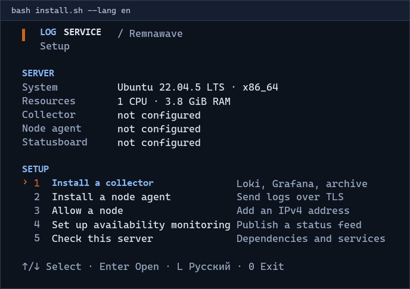

# Remnawave Log Service

Collect Xray access and error logs from your Remnawave nodes. View recent logs in Grafana using Loki. Keep older logs on local disk, in S3-compatible storage, or in Google Drive. The stack runs on your servers.

**English** · [Русский](README.ru.md)

[](https://github.com/evi1argument/remnawave-log-service/actions/workflows/check.yml)
[](LICENSE)
[](https://vector.dev/)
[](https://grafana.com/oss/loki/)
[](https://grafana.com/oss/grafana/)

[Guided setup](#guided-setup) · [Installation and storage (RU)](docs/INSTALLATION.md) · [Upgrade and rollback (RU)](docs/UPGRADING.md) · [Reports (RU)](report/README.md)

## What runs where

| Where | What it does |
| --- | --- |
| On each VPN node | A Vector agent reads Xray log files and sends them over TLS. It verifies the collector certificate. |
| On the collector | Vector receives the logs. Loki keeps 30 days searchable by default. Grafana displays the logs, and a separate archive job stores them for longer if configured. |

## Guided setup

Use a dedicated Debian or Ubuntu collector and install [Docker Engine 28+ with the Compose plugin](https://docs.docker.com/engine/install/) on the collector and nodes. The collector needs Docker's iptables backend. You also need root access and an IPv4 path from each node. [Configure Xray to write log files](docs/INSTALLATION.md#prepare-xray).

Before installing, restrict collector TCP/6000 to your node addresses at the provider firewall or use a private network. Grafana and Loki listen on the collector's loopback interface.

Clone the stable release on the collector and on each node.

```bash
git clone --branch v1.3.0 https://github.com/evi1argument/remnawave-log-service.git
cd remnawave-log-service
```

Run `sudo bash install.sh --lang en` for English or `sudo bash install.sh --lang ru` for Russian. Use the arrow keys or the item number, then press **Enter**.

<a href="docs/images/installer-en.png"></a>

1. On the collector, choose **Install a collector**. The wizard sets up a local archive and asks how long to keep it. Supply an age public key if you want encryption.
2. Copy `/opt/logcollector/vector/tls/cert.pem` from the collector to each node over SSH after verifying the collector's host key. On each node, choose **Install a node agent** and give the wizard the path to that public certificate.
3. On the collector, choose **Allow a node**. Enter the source IPv4 address the collector sees. For a node behind NAT, enter its outbound IPv4 address.
4. From your own computer, open an SSH tunnel to Grafana. Replace `COLLECTOR` with the collector's address.

```bash
ssh -N -L 3000:127.0.0.1:3000 root@COLLECTOR
```

Open `http://127.0.0.1:3000` and sign in as `admin`. The password is in `/opt/logcollector/.env` on the collector. Open **Remnawave Logs → Log search** and check for a recent entry from the node.

For S3, Google Drive, or a collector that also runs a VPN node, follow the [manual installation guide (RU)](docs/INSTALLATION.md). For an existing setup, use the [upgrade guide (RU)](docs/UPGRADING.md).

## Search and monitor

- **Search Xray logs.** Use **Fleet overview** to see activity by node and **Log search** to filter by node, IP address, user ID, or destination. The command-line report supports account lookup on Remnawave 2.x and 3.x. [Report examples (RU)](report/README.md)
- **Check log delivery.** Each enabled node can write a test line once a minute. Query Loki to see which nodes are still sending records, even when nobody is connected to the VPN. [Log delivery setup (RU)](docs/LOG-DELIVERY.md)
- **Send error alerts to Telegram.** Configure Grafana to alert when a node writes an unusual number of lines to `error.log`. [Telegram setup (RU)](docs/TELEGRAM.md)
- **Check node availability.** Statusboard can report what the panel sees or run an actual VPN request from a separate client. [Statusboard setup](statusboard/README.md)

## Log access and project checks

Xray access logs can include client IP addresses, destinations, and numeric account IDs. Limit who can read them, set retention for both Loki and the archive, and keep the private age key off the collector. [Security policy](SECURITY.md)

Linux CI checks TLS log delivery, Grafana dashboards, and a local encrypted archive round trip. Validate live S3 or Google Drive access and existing Grafana database migrations in your own environment. [Releases](https://github.com/evi1argument/remnawave-log-service/releases)
