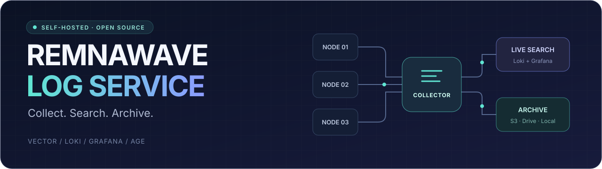
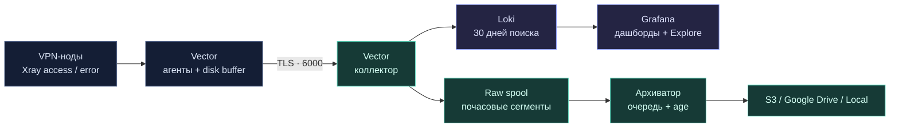

<div align="center">



<br />

**Русский** · [English](README.en.md)

[](https://github.com/evi1argument/remnawave-log-service/actions/workflows/check.yml)
[](LICENSE)
[](https://vector.dev/)
[](https://grafana.com/oss/loki/)
[](https://grafana.com/oss/grafana/)

### Логи всего VPN-парка. Один коллектор. Ваше хранилище.

Сбор access/error-логов Xray для Remnawave, поиск в Grafana<br />
и зашифрованный архив в S3, Google Drive или на своём диске.

[Быстрый старт](#быстрый-старт) · [Установка](docs/INSTALLATION.md) · [Обновление](docs/UPGRADING.md) · [Отчёты](report/README.md)

</div>

---

# Remnawave Log Service

> **Развёртывание.** Используйте выделенный Linux-хост. Оставьте
> Grafana и Loki доступными только локально, а TCP/6000 ограничьте адресами нод
> на сетевом firewall. См. [установку](docs/INSTALLATION.md) и [политику безопасности](SECURITY.md).

## Что внутри

| 📡 Сбор | 🔎 Поиск | 🔐 Архив |
| :--- | :--- | :--- |
| Vector на каждой ноде | Loki + два дашборда Grafana | S3, Google Drive или локальный диск |
| Передача по TLS | Фильтры по ноде, IP, пользователю и домену | Опциональное шифрование `age` |
| Дисковые очереди и подтверждения | CLI-отчёты по соединениям | Повторы загрузки и защита от перезаписи сегментов |

Связка числового ID с аккаунтом остаётся на сервере панели. Коллектор хранит логи,
а сопоставление пользователя выполняется отдельно — по запросу.

## Как это работает



Оперативный поиск и долгий архив разделены: Loki может удалять старые чанки,
а S3-архив — использовать Object Lock. Ограничения гарантий доставки описаны
в [руководстве по обновлению](docs/UPGRADING.md).

## Быстрый старт

Нужны Debian/Ubuntu, root-доступ и ноды, у которых Xray пишет логи в файлы.
Заранее установите Docker Engine 28+ и плагин Compose. Настройте сетевой firewall
коллектора до установки. Подробности — в [руководстве](docs/INSTALLATION.md).

**1. Поднимите коллектор**

```bash
git clone --branch v1.2.0 https://github.com/evi1argument/remnawave-log-service.git
cd remnawave-log-service/collector
./install-collector.sh
```

Инсталлятор спросит настройки архива и выведет готовую команду для подключения нод.
Для отдельного VPS без VPN-ноды укажите `COLLECTOR_NODE=-`.

**2. Подключите каждую ноду**

```bash
git clone --branch v1.2.0 https://github.com/evi1argument/remnawave-log-service.git
cd remnawave-log-service/node
scp root@COLLECTOR:/opt/logcollector/vector/tls/cert.pem ./collector.crt
COLLECTOR_CERT=./collector.crt COLLECTOR_IP=COLLECTOR ./install-node.sh NODE_NAME
```

Замените `COLLECTOR` и `NODE_NAME` на свои значения. Проверьте SSH-ключ хоста
перед копированием сертификата. На коллекторе разрешите исходящий IPv4-адрес ноды
в сетевом firewall и командой `/opt/logcollector/scripts/collector-add-node-fw.sh NODE_IP`.
Приёмник фильтруется в `DOCKER-USER`: Docker обходит обычные правила UFW.

**3. Откройте Grafana через SSH**

```bash
ssh -L 3000:127.0.0.1:3000 root@<IP_коллектора>
```

Перейдите на `http://127.0.0.1:3000` → папка **Remnawave Logs**.
Grafana и Loki публикуются только на loopback.

> **Перед обновлением существующего стека** прочитайте [порядок обновления и отката](docs/UPGRADING.md).
> Инсталлятор создаёт настройки заново; это не универсальный updater.

## Выберите свой архив

| Бэкенд | Когда подходит | Защита от удаления |
| :--- | :--- | :--- |
| **S3** | Долгое хранение в AWS, MinIO, Selectel, Backblaze, Wasabi | Object Lock — если поддерживается и настроен в бакете |
| **Google Drive** | Привычное облако; другие сервисы через rclone | Нет встроенной WORM-защиты |
| **Local** | Свой диск и выгрузка на ПК через SSH | Зависит от файловой системы и резервного копирования |

Для облачного архива рекомендуется `ENCRYPT=age`: на коллекторе нужен только публичный
ключ, приватный ключ расшифрования хранится отдельно. Cadence: `hourly`, `daily` или `weekly`.

## Дашборды и расследования

- **Fleet overview** — общий обзор логов парка.
- **Log search** — поиск и фильтрация событий.
- **CLI** — цепочка соединений по IP, пользователю или домену за период.

```bash
/opt/logcollector/report/investigate.sh --from -24h --ip 203.0.113.7
/opt/logcollector/report/investigate.sh --from -7d --user 42
```

Поддерживаются Remnawave 2.x и 3.x. [Как работать с отчётами →](report/README.md)

## Оповещения в Telegram

- [Проверка доставки логов](docs/LOG-DELIVERY.md) — контрольная запись от ноды до Loki, независимо от пользовательского трафика.
- [Подключение Telegram в Grafana](docs/TELEGRAM.md) — правило для всплеска строк в `error.log` по нодам, шаблон уведомления и сценарий проверки.

## Проверки

CI проверяет синтаксис Bash, архиватор, конфиги и оба установщика, а также путь
синтетических логов: TLS-агент → коллектор → Loki + raw spool → Grafana.

```bash
sudo python3 -m unittest discover -s tests -v
bash scripts/check-configs.sh
sudo python3 tests/smoke_stack.py
```

Тесты рассчитаны на Linux; нужны Docker, Python 3, OpenSSL, `age`, `psmisc` и `util-linux`.
Тестовый стек использует временные данные, внутреннюю сеть и не публикует порты.
Миграция существующей БД Grafana и реальные запросы к S3/Drive проверяются отдельно.

## Навигация по проекту

| Каталог | Назначение |
| :--- | :--- |
| [`collector/`](collector/) | Loki, Grafana, Vector, архиватор и systemd |
| [`node/`](node/) | Агент Vector и ротация логов ноды |
| [`report/`](report/) | Выборка соединений и сопоставление ID на панели |
| [`scripts/`](scripts/) | TLS, firewall, выгрузка архива и проверки конфигов |
| [`tests/`](tests/) | Регрессионные сценарии и тест полного стека |
| [`docs/`](docs/) | Установка, обновление, ограничения и источники |

---

<div align="center">

**Ваши логи. Ваша инфраструктура. Ваши ключи.**

[MIT License](LICENSE) · [Сообщить об ошибке](https://github.com/evi1argument/remnawave-log-service/issues)

</div>
