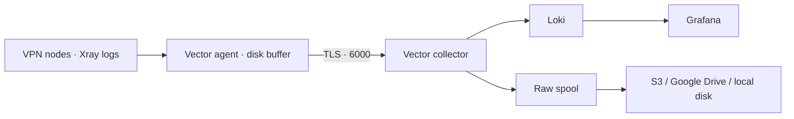

<div align="center">


**English** · [Русский](README.ru.md)

[](https://github.com/evi1argument/remnawave-log-service/actions/workflows/check.yml)
[](LICENSE)

</div>

# Remnawave Log Service

Self-hosted log collection for Remnawave VPN fleets. Collect Xray access and
error logs over TLS with Vector, search them in Grafana with Loki, and archive
them to S3, Google Drive, or local storage with optional age encryption.

> **Deployment.** Use a dedicated Linux host. Keep Grafana and
> Loki on loopback and restrict collector TCP/6000 to your nodes at the network
> perimeter. See the [security policy](SECURITY.md) for reporting issues.

## How it works

| Collect | Search | Archive |
| --- | --- | --- |
| Vector agents with disk buffers | Loki and two dashboards in Grafana | S3, Google Drive, or local storage |
| Agents verify the collector certificate | Filter by node, IP, user ID, and destination | Optional age encryption and upload retries |

The mapping between numeric log IDs and account details stays on the panel
server. Looking up an account is a separate step. VPN logs can still contain
identifying information; restrict access and set retention accordingly.



## Optional availability monitoring

[Statusboard](statusboard/README.md) records Remnawave node status or independent VPN probe results. Its daily history uses 96 closed intervals and reports measurement coverage separately.

## Quick start

### Guided setup

You need Debian or Ubuntu with systemd, root access, IPv4 and
[Docker Engine 28+ with the Compose plugin](https://docs.docker.com/engine/install/).
Use Docker's iptables backend on the collector. Restrict TCP/6000 at the
provider firewall or use a private network before starting Docker services.

Clone the repository and open the setup menu:

```bash
git clone --branch v1.3.0 https://github.com/evi1argument/remnawave-log-service.git
cd remnawave-log-service
sudo bash install.sh
```

In a terminal, use **↑/↓** and **Enter** to open an action, or type its number
and press **Enter**. Use **L** to switch between English and Russian, or start directly
in Russian with `sudo bash install.sh --lang ru`. The same option works with
subcommands, for example `sudo bash install.sh --lang ru doctor`.

<a href="docs/images/installer-en.png"></a>

1. On the collector, choose **Install a collector**. The guided path uses a local archive with configurable retention and optional age encryption.
2. Transfer the collector's public certificate to each node over trusted SSH. Run the menu on each node and choose **Install a node agent**.
3. Back on the collector, choose **Allow a node** for each agent address.
4. Use **Check this server** for diagnostics. The optional availability monitor needs a local Remnawave API endpoint and a panel API token.

The guided setup is for fresh installations. It detects any existing configuration on the host. Run the collector and node actions on their respective servers. Use the guides below for S3, Google Drive, upgrades and migration.

### Manual setup

**1. Install the collector**

```bash
git clone --branch v1.3.0 https://github.com/evi1argument/remnawave-log-service.git
cd remnawave-log-service/collector
./install-collector.sh
```

The installer prompts for the archive backend and encryption settings. For a
dedicated collector that does not run a VPN node, use `COLLECTOR_NODE=-`.
The Grafana admin password is stored in `/opt/logcollector/.env` with access
restricted to root.

**2. Install each agent**

Run the following on a node where Xray writes access and error logs to
`/var/log/remnanode/`. Replace `COLLECTOR` and `NODE_NAME`. Verify the collector's
SSH host key before copying the public certificate.

```bash
git clone --branch v1.3.0 https://github.com/evi1argument/remnawave-log-service.git
cd remnawave-log-service/node
scp root@COLLECTOR:/opt/logcollector/vector/tls/cert.pem ./collector.crt
COLLECTOR_CERT=./collector.crt COLLECTOR_IP=COLLECTOR ./install-node.sh NODE_NAME
```

On the collector, add the node's actual source IPv4 address to the provider
firewall and to Docker's allow-list. If the node uses NAT, use its egress IP.

```bash
/opt/logcollector/scripts/collector-add-node-fw.sh NODE_IP
```

**3. Open Grafana over SSH**

```bash
ssh -N -L 3000:127.0.0.1:3000 root@COLLECTOR
```

Open `http://127.0.0.1:3000`, sign in as `admin`, and open the
**Remnawave Logs** folder. Confirm the node appears in **Fleet overview** and
search for a recent event in **Log search**.

## Choose an archive backend

| Backend | Setup | Protection from deletion |
| --- | --- | --- |
| S3 | Create a bucket and a scoped service key. | Object Lock with versioning, where supported. |
| Google Drive | Configure an rclone remote and use age encryption. | Drive has no built-in immutable retention. |
| Local | Store archives on a local disk and optionally pull them with `scripts/pull-to-pc.sh` over SSH. | Depends on filesystem permissions and backups. |

For age encryption, keep the private key off the collector. Loki's searchable
retention is separate from archive retention. Archive scheduling supports
`hourly`, `daily`, and `weekly`. To run the archive job manually:

```bash
systemctl start archive-upload.service
journalctl -u archive-upload.service -n 20
```

## Dashboards and investigations

- **Fleet overview** shows logs across the fleet.
- **Log search** filters events by node, IP, user ID, or destination.
- **CLI reporting** looks up connections over a time range. Account lookup supports Remnawave 2.x and 3.x.

```bash
/opt/logcollector/report/investigate.sh --from -24h --ip 203.0.113.7
/opt/logcollector/report/investigate.sh --from -7d --user 42
```

## Telegram alerts

- The [log delivery guide (Russian)](docs/LOG-DELIVERY.md) illustrates how to check each node's synthetic marker in Loki, independent of client traffic.
- The [Telegram setup guide (Russian)](docs/TELEGRAM.md) includes example messages, an optional Grafana rule for per-node spikes in Xray error log volume, a notification template, and a test procedure.

## Validation and upgrades

CI covers Bash syntax, archive regressions, configuration validation, and a
fresh collector and agent installation on Linux. It checks TLS delivery to
Loki, Grafana dashboards, and encryption and decryption of a local archive.
Live S3 and Google Drive or migration of an existing Grafana database need
separate validation. Review the [release notes](https://github.com/evi1argument/remnawave-log-service/releases)
for current limitations.

Back up settings, certificates, the archive queue, and volumes before upgrading.
The install scripts regenerate configuration. Follow the upgrade guide for an
existing installation.

```bash
sudo python3 -m unittest discover -s tests -v
bash scripts/check-configs.sh
sudo python3 tests/smoke_stack.py
```

The tests use Linux, Docker, Python 3, OpenSSL, `age`, `psmisc`, and `util-linux`.
The smoke test uses temporary data and a private Docker network.

- [Installation guide (Russian)](docs/INSTALLATION.md)
- [Upgrade and rollback guide (Russian)](docs/UPGRADING.md)
- [CLI reports and account lookup (Russian)](report/README.md)
- [Security policy](SECURITY.md) · [MIT license](LICENSE)

## Repository map

| Path | Contents |
| --- | --- |
| [`collector/`](collector/) | Loki, Grafana, Vector, archiving and systemd units |
| [`node/`](node/) | Vector agent and Xray log rotation |
| [`report/`](report/) | Connection reports and account lookup |
| [`scripts/`](scripts/) | TLS, firewall, archive retrieval and config validation |
| [`statusboard/`](statusboard/) | Availability collector and VPN probes |
| [`tests/`](tests/) | Regression and integration tests |
| [`docs/`](docs/) | Installation, upgrades and operating guides |
