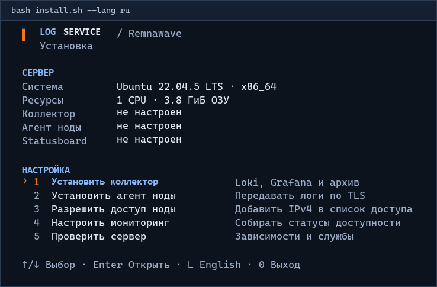

# Remnawave Log Service

Собирайте журналы доступа и ошибок Xray с нод Remnawave. Свежие записи можно искать в Grafana через Loki, а архив хранить на диске, в S3-совместимом хранилище или Google Drive. Всё работает на ваших серверах.

[English](README.md) · **Русский**

[](https://github.com/evi1argument/remnawave-log-service/actions/workflows/check.yml)
[](LICENSE)
[](https://vector.dev/)
[](https://grafana.com/oss/loki/)
[](https://grafana.com/oss/grafana/)

[Мастер установки](#мастер-установки) · [Установка и выбор хранилища](docs/INSTALLATION.md) · [Обновление и откат](docs/UPGRADING.md) · [Отчёты](report/README.md)

## Что на каком сервере работает

| Где | Что делает |
| --- | --- |
| На каждой VPN-ноде | Агент Vector читает файлы Xray и отправляет записи по TLS. При подключении он проверяет сертификат коллектора. |
| На коллекторе | Vector принимает записи. В Loki по умолчанию доступны для поиска последние 30 дней. Grafana показывает логи, а отдельная задача складывает их в архив для более долгого хранения. |

## Мастер установки

Выделите под коллектор сервер с Debian или Ubuntu. На нём и на нодах установите [Docker Engine 28+ с плагином Compose](https://docs.docker.com/engine/install/). На коллекторе Docker должен использовать iptables. Нужен доступ root и соединение по IPv4 от каждой ноды до коллектора. [Настройте запись логов Xray в файлы](docs/INSTALLATION.md#prepare-xray).

Перед установкой откройте TCP/6000 в межсетевом экране провайдера только для адресов своих нод или используйте закрытую сеть. Grafana и Loki принимают подключения на коллекторе через локальный адрес.

Склонируйте стабильный выпуск на коллекторе и на каждой ноде.

```bash
git clone --branch v1.3.0 https://github.com/evi1argument/remnawave-log-service.git
cd remnawave-log-service
```

Запустите `sudo bash install.sh --lang ru` для русского меню или `sudo bash install.sh --lang en` для английского. Выберите пункт стрелками или введите его номер, затем нажмите **Enter**.

<a href="docs/images/installer-ru.png"></a>

1. На коллекторе выберите **Установить коллектор**. Мастер настроит локальный архив и спросит, сколько дней его хранить. Если нужно шифрование, укажите открытый ключ age.
2. Скопируйте `/opt/logcollector/vector/tls/cert.pem` с коллектора на каждую ноду по SSH, предварительно проверив ключ хоста. На ноде выберите **Установить агент ноды** и укажите путь к скопированному сертификату.
3. На коллекторе выберите **Разрешить доступ ноды**. Введите IPv4-адрес, с которого коллектор видит подключение. Если нода за NAT, укажите её внешний IPv4.
4. Со своего компьютера откройте SSH-туннель к Grafana. Замените `COLLECTOR` адресом коллектора.

```bash
ssh -N -L 3000:127.0.0.1:3000 root@COLLECTOR
```

Откройте `http://127.0.0.1:3000` и войдите как `admin`. Пароль лежит в `/opt/logcollector/.env` на коллекторе. Откройте **Remnawave Logs → Log search** и найдите свежую запись с ноды.

Для S3, Google Drive или коллектора, который одновременно служит VPN-нодой, используйте [ручную установку](docs/INSTALLATION.md). Если сервис уже работает, следуйте [руководству по обновлению](docs/UPGRADING.md).

## Поиск и мониторинг

- **Найти запись Xray.** В **Fleet overview** видна активность по нодам. В **Log search** можно выбрать ноду, IP-адрес, ID пользователя или адрес назначения. Утилита отчётов умеет искать аккаунты в Remnawave 2.x и 3.x. [Примеры отчётов](report/README.md)
- **Проверить доставку логов.** На выбранных нодах можно раз в минуту писать контрольную строку. Запрос к Loki покажет, с каких нод приходят записи, даже когда у VPN нет клиентов. [Настройка проверки доставки](docs/LOG-DELIVERY.md)
- **Получать уведомления в Telegram.** Настройте правило Grafana, чтобы оно срабатывало при всплеске строк в `error.log` на ноде. [Настройка Telegram](docs/TELEGRAM.md)
- **Проверить доступность нод.** Statusboard показывает состояние по данным панели или выполняет запрос через VPN с отдельного клиента. [Настройка Statusboard](statusboard/README.ru.md)

## Доступ к логам и проверки проекта

Журналы доступа Xray могут содержать IP-адреса клиентов, адреса назначения и числовые ID аккаунтов. Ограничьте круг тех, кто может читать логи, настройте сроки хранения в Loki и архиве и держите закрытый ключ age за пределами коллектора. [Политика безопасности](SECURITY.md)

Linux CI проверяет доставку логов по TLS, дашборды Grafana и запись и расшифровку локального архива. Доступ к S3 или Google Drive и миграцию существующей базы Grafana проверяйте на своей установке. [Релизы](https://github.com/evi1argument/remnawave-log-service/releases)
