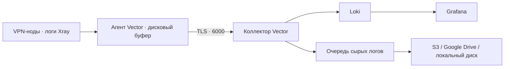

<div align="center">


[English](README.md) · **Русский**

[](https://github.com/evi1argument/remnawave-log-service/actions/workflows/check.yml)
[](LICENSE)

</div>

# Remnawave Log Service

Сбор логов VPN-нод Remnawave на своей инфраструктуре. Vector передаёт журналы доступа и ошибок Xray по TLS. Логи доступны для поиска через Loki в Grafana, а архив можно хранить в S3, Google Drive или на локальном диске с шифрованием age.

> **Развёртывание.** Используйте отдельный Linux-сервер. Оставьте Grafana и Loki доступными только через loopback. Ограничьте TCP/6000 на сетевом периметре коллектора адресами нод. Как сообщить об уязвимости, указано в [политике безопасности](SECURITY.md).

## Как это работает

| Сбор | Поиск | Архив |
| --- | --- | --- |
| Агенты Vector с дисковыми буферами | Loki и два дашборда в Grafana | S3, Google Drive или локальный диск |
| Агенты проверяют сертификат коллектора | Фильтры по ноде, IP, ID пользователя и адресу назначения | Шифрование age и повторные попытки загрузки |

Соответствие числовых ID аккаунтам остаётся на сервере панели. Поиск аккаунта выполняется отдельно. Логи VPN могут содержать идентифицирующую информацию, поэтому ограничьте доступ и настройте срок хранения.



## Опциональный мониторинг доступности

[Statusboard](statusboard/README.ru.md) сохраняет состояние нод Remnawave или результаты независимых сквозных VPN-проверок. Суточная история содержит 96 закрытых интервалов. Покрытие замеров публикуется отдельно.

## Быстрый старт

### Мастер установки

Нужны Debian или Ubuntu с systemd, root-доступ, IPv4 и [Docker Engine 28+ с плагином Compose](https://docs.docker.com/engine/install/). Используйте iptables как бэкенд Docker на коллекторе. Перед запуском контейнеров ограничьте TCP/6000 в firewall провайдера или используйте приватную сеть.

Клонируйте репозиторий и запустите меню:

```bash
git clone --branch v1.3.0 https://github.com/evi1argument/remnawave-log-service.git
cd remnawave-log-service
sudo bash install.sh
```

В терминале выберите действие стрелками **↑/↓** или его номером и нажмите **Enter**.
Клавиша **L** переключает английский и русский. Также можно
запустите мастер сразу на русском командой `sudo bash install.sh --lang ru`.
Флаг работает и с подкомандами, например `sudo bash install.sh --lang ru doctor`.

<a href="docs/images/installer-ru.png"></a>

1. На коллекторе выберите **Install a collector**. Мастер настраивает локальный архив со сроком хранения и опциональным шифрованием age.
2. Перенесите публичный сертификат коллектора на каждую ноду через доверенное SSH-соединение. Запустите меню на ноде и выберите **Install a node agent**.
3. На коллекторе выберите **Allow a node** для каждого адреса агента.
4. Для диагностики используйте **Check this server**. Для опционального мониторинга доступности нужны локальный API Remnawave и API-токен панели.

Мастер предназначен для новой установки и проверяет наличие существующей конфигурации. Запускайте шаги для коллектора и ноды на соответствующих серверах. Для S3, Google Drive, обновления и переноса используйте руководства ниже.

### Ручная установка

**1. Установите коллектор**

```bash
git clone --branch v1.3.0 https://github.com/evi1argument/remnawave-log-service.git
cd remnawave-log-service/collector
./install-collector.sh
```

Инсталлятор запрашивает тип архива и параметры шифрования. Для выделенного коллектора без VPN-ноды используйте `COLLECTOR_NODE=-`. Пароль администратора Grafana хранится в `/opt/logcollector/.env` с доступом только для root.

**2. Установите каждый агент**

Выполните на ноде, где Xray пишет журналы доступа и ошибок в `/var/log/remnanode/`. Замените `COLLECTOR` и `NODE_NAME`. Проверьте ключ SSH-хоста коллектора перед копированием публичного сертификата.

```bash
git clone --branch v1.3.0 https://github.com/evi1argument/remnawave-log-service.git
cd remnawave-log-service/node
scp root@COLLECTOR:/opt/logcollector/vector/tls/cert.pem ./collector.crt
COLLECTOR_CERT=./collector.crt COLLECTOR_IP=COLLECTOR ./install-node.sh NODE_NAME
```

На коллекторе добавьте фактический IPv4 источника ноды в firewall провайдера и список разрешений Docker. При NAT используйте выходной IP.

```bash
/opt/logcollector/scripts/collector-add-node-fw.sh NODE_IP
```

**3. Откройте Grafana через SSH**

```bash
ssh -N -L 3000:127.0.0.1:3000 root@COLLECTOR
```

Откройте `http://127.0.0.1:3000`, войдите как `admin` и откройте папку **Remnawave Logs**. Убедитесь, что нода видна в **Fleet overview**, и найдите свежее событие в **Log search**.

## Выбор архива

| Бэкенд | Настройка | Защита от удаления |
| --- | --- | --- |
| S3 | Создайте бакет и сервисный ключ с ограниченными правами. | Object Lock с версионированием, если их поддерживает хранилище. |
| Google Drive | Настройте rclone remote и используйте шифрование age. | Встроенного неизменяемого хранения нет. |
| Local | Храните архивы на локальном диске. Для выгрузки по SSH можно использовать `scripts/pull-to-pc.sh`. | Зависит от прав файловой системы и резервных копий. |

Храните приватный ключ age вне коллектора. Срок доступности логов для поиска в Loki задаётся отдельно от срока хранения архивов. Периодичность архивации — `hourly`, `daily` или `weekly`. Для ручного запуска:

```bash
systemctl start archive-upload.service
journalctl -u archive-upload.service -n 20
```

## Дашборды и расследования

- **Fleet overview** показывает логи по всему парку.
- **Log search** фильтрует события по ноде, IP, ID пользователя или адресу назначения.
- **CLI-отчёты** позволяют находить подключения за выбранный период. Поиск аккаунтов поддерживает Remnawave 2.x и 3.x.

```bash
/opt/logcollector/report/investigate.sh --from -24h --ip 203.0.113.7
/opt/logcollector/report/investigate.sh --from -7d --user 42
```

## Оповещения в Telegram

- [Руководство по проверке доставки логов](docs/LOG-DELIVERY.md) показывает, как проверять контрольную запись каждой ноды в Loki независимо от пользовательского трафика.
- [Руководство по Telegram](docs/TELEGRAM.md) содержит примеры сообщений, опциональное правило Grafana для всплесков `error.log` по нодам, шаблон уведомления и процедуру проверки.

## Проверки и обновление

CI проверяет синтаксис Bash, архиватор, конфигурацию и установку коллектора и агента на Linux с нуля. Проверяется доставка по TLS в Loki, наличие дашбордов Grafana, шифрование и расшифровка локального архива. Работу с реальными S3 и Google Drive и миграцию существующей базы Grafana проверяйте отдельно. Актуальные ограничения описаны в [заметках к релизам](https://github.com/evi1argument/remnawave-log-service/releases).

Перед обновлением сохраните конфигурацию, сертификаты, очередь архива и тома. Установщики генерируют конфигурацию заново. Для действующей установки следуйте руководству по обновлению.

```bash
sudo python3 -m unittest discover -s tests -v
bash scripts/check-configs.sh
sudo python3 tests/smoke_stack.py
```

Для тестов нужны Linux, Docker, Python 3, OpenSSL, `age`, `psmisc` и `util-linux`. Тест стека использует временные данные и приватную сеть Docker.

- [Установка](docs/INSTALLATION.md)
- [Обновление и откат](docs/UPGRADING.md)
- [CLI-отчёты и поиск аккаунтов](report/README.md)
- [Политика безопасности](SECURITY.md) · [Лицензия MIT](LICENSE)

## Карта репозитория

| Каталог | Содержимое |
| --- | --- |
| [`collector/`](collector/) | Loki, Grafana, Vector, архиватор и службы systemd |
| [`node/`](node/) | Агент Vector и ротация журналов Xray |
| [`report/`](report/) | Отчёты о подключениях и поиск аккаунтов |
| [`scripts/`](scripts/) | TLS, firewall, выгрузка архива и проверка конфигурации |
| [`statusboard/`](statusboard/) | Сборщик доступности и сквозные VPN-пробы |
| [`tests/`](tests/) | Регрессионные и интеграционные тесты |
| [`docs/`](docs/) | Руководства по установке, обновлению и эксплуатации |
